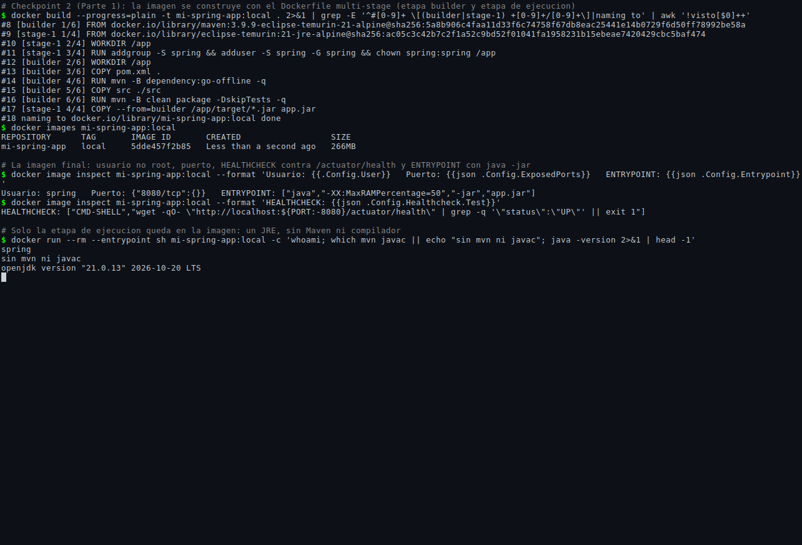
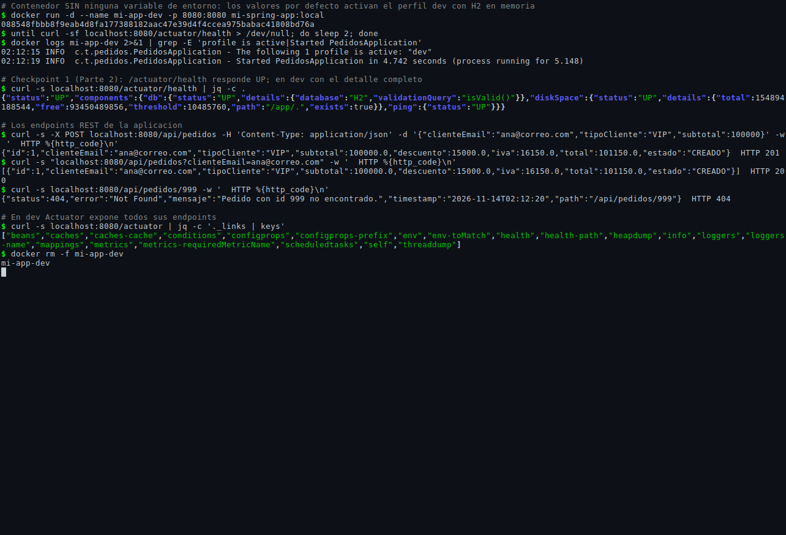
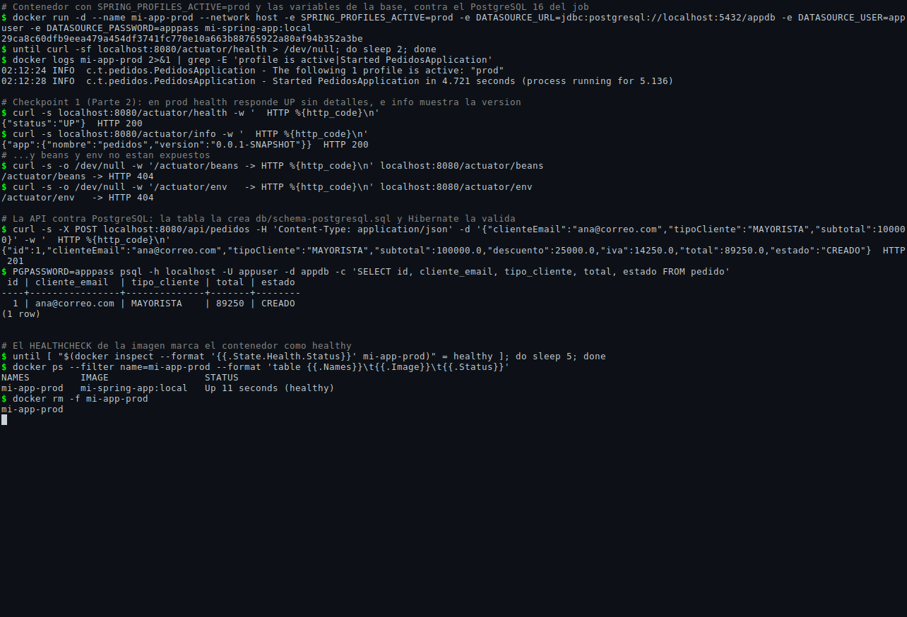
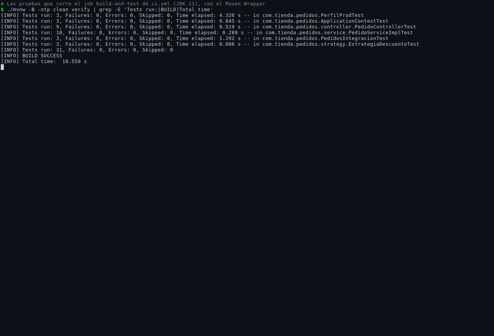
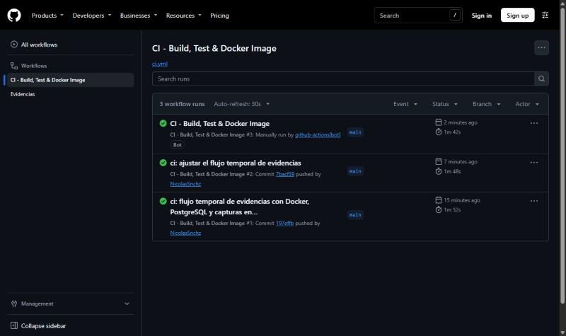
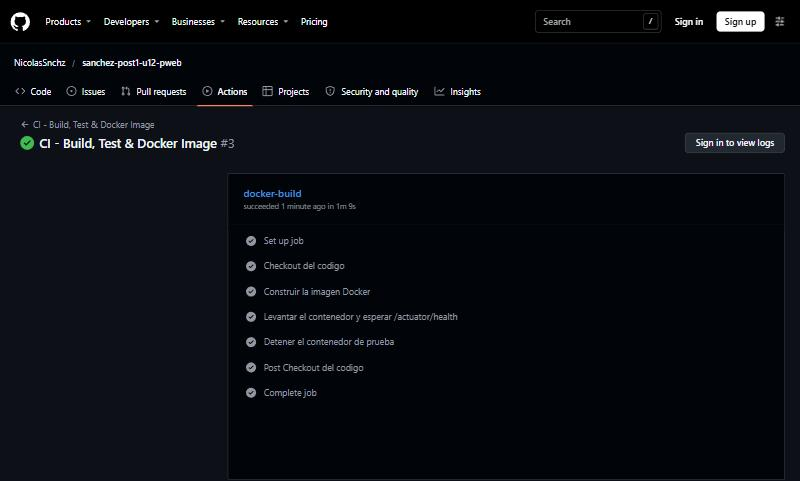

# Post-contenido, Unidad 12: Despliegue y CI/CD

**Estudiante:** Nicolás Andrés Sánchez Villamizar · Programación Web · Universidad de Santander (UDES)


## Descripción

Repositorio del laboratorio de la Unidad 12 de Programación Web. La aplicación es la de pedidos de la Unidad 11:

- API REST `/api/pedidos` con la entidad JPA `Pedido`;
- patrón Strategy para el descuento;
- manejo centralizado de errores;
- Swagger en `/swagger-ui.html`.

En este laboratorio le agregué dos cosas. En la Parte 1, un Dockerfile multi-stage con perfiles `dev`/`prod` activados por variable de entorno. En la Parte 2, un pipeline de GitHub Actions y monitoreo con Spring Boot Actuator.

Todas las capturas de terminal salen de ejecuciones reales en GitHub Actions: Docker, un PostgreSQL 16 de verdad y `curl` en una terminal. Las capturas de GitHub son la pestaña Actions de este repositorio.

## Parte 1: Dockerización con perfiles y variables de entorno

### Dockerfile multi-stage

[`Dockerfile`](Dockerfile):

| Etapa | Qué hace |
|---|---|
| Compilación ([líneas 6 a 15](Dockerfile#L6-L15)) | `maven:3.9.9-eclipse-temurin-21-alpine`. Copia primero `pom.xml` y descarga las dependencias (`dependency:go-offline`), así esa capa queda en caché mientras el `pom` no cambie. Después copia `src/` y empaqueta. |
| Ejecución ([líneas 18 a 37](Dockerfile#L18-L37)) | `eclipse-temurin:21-jre-alpine`, solo el JRE. Crea el usuario no root `spring` y le da `/app`. Copia únicamente el JAR. Expone 8080, define un `HEALTHCHECK` contra `/actuator/health` y arranca con `ENTRYPOINT ["java", ..., "-jar", "app.jar"]`. |

[`.dockerignore`](.dockerignore) deja fuera `target/`, `.git/`, `.github/`, `.mvn/`, `logs/` y los `.md`. A la imagen solo entran `pom.xml` y `src/`.



La imagen pesa **266 MB**, por debajo del límite de 300 MB del Checkpoint 2. `whoami` dentro del contenedor responde `spring`, y en la imagen final no hay `mvn` ni `javac`.

### Perfiles y placeholders

[`application.properties`](src/main/resources/application.properties) solo tiene lo común: el puerto (`${PORT:8080}`) y el perfil activo (`${SPRING_PROFILES_ACTIVE:dev}`). Los valores que cambian por ambiente están en dos archivos:

| | [`application-dev.properties`](src/main/resources/application-dev.properties) | [`application-prod.properties`](src/main/resources/application-prod.properties) |
|---|---|---|
| Base de datos | `${DATASOURCE_URL:jdbc:h2:mem:devdb...}` | `${DATASOURCE_URL:...}` → PostgreSQL |
| Esquema | `ddl-auto=create-drop` | Script [`schema-postgresql.sql`](src/main/resources/db/schema-postgresql.sql) + `ddl-auto=validate` |
| Logs | `com.tienda.pedidos` en DEBUG, consola y archivo | `root` en WARN, `com.tienda.pedidos` en INFO, solo consola |
| Actuator | todos los endpoints, health con detalle | solo `health` e `info`, sin detalle |

Variables de entorno:

| Variable | Perfil | Por defecto | Para qué |
|---|---|---|---|
| `SPRING_PROFILES_ACTIVE` | ambos | `dev` | Elige el perfil |
| `PORT` | ambos | `8080` | Puerto HTTP (Render lo fija solo) |
| `DATASOURCE_URL` | ambos | H2 en memoria / `jdbc:postgresql://localhost:5432/appdb` | URL JDBC completa |
| `DATASOURCE_HOST`, `DATASOURCE_PORT`, `DATASOURCE_DB` | prod | `localhost`, `5432`, `appdb` | Alternativa a `DATASOURCE_URL`, como las entrega Render |
| `DATASOURCE_USER` | ambos | `sa` / `appuser` | Usuario |
| `DATASOURCE_PASSWORD` | ambos | vacía | Contraseña. En prod no tiene un valor utilizable: siempre llega por variable |
| `DATASOURCE_DRIVER` | dev | `org.h2.Driver` | En prod el driver se deduce de la URL |

El proyecto no usa JWT, así que no hay `JWT_SECRET`.

**Contenedor sin ninguna variable de entorno.** Arranca con el perfil `dev` y H2. El log dice `The following 1 profile is active: "dev"`, `/actuator/health` responde UP con el detalle de la base y el disco, y la API responde 201, 200 y 404:



**Contenedor con `SPRING_PROFILES_ACTIVE=prod` y las variables de la base, contra un PostgreSQL 16.** En la captura:

- El log dice `The following 1 profile is active: "prod"`.
- `/actuator/health` responde solo `{"status":"UP"}`.
- `/actuator/beans` y `/actuator/env` responden **404**.
- El pedido queda guardado en PostgreSQL (consulta con `psql`).
- El `HEALTHCHECK` deja el contenedor en **healthy**.



## Parte 2: Pipeline CI/CD con GitHub Actions y monitoreo con Actuator

### Actuator

`spring-boot-starter-actuator` está en el [`pom.xml`](pom.xml). La exposición está diferenciada por perfil: todo en dev ([líneas 12 y 13](src/main/resources/application-dev.properties#L12-L13)) y solo `health` e `info` en prod ([líneas 22 y 23](src/main/resources/application-prod.properties#L22-L23)). `/actuator/info` muestra el nombre y la versión del artefacto, que se toman del `pom.xml` al compilar ([líneas 14 a 17](src/main/resources/application.properties#L14-L17)).

### Pruebas

La aplicación ya traía las 25 pruebas de la Unidad 11. Para el pipeline agregué:

| Clase | Qué comprueba |
|---|---|
| [`ApplicationContextTest`](src/test/java/com/tienda/pedidos/ApplicationContextTest.java) | La prueba de contexto de la guía: el contexto completo arranca con `@ActiveProfiles("dev")`. Además comprueba que el perfil activo sea `dev`, que `/actuator/health` responda UP con la base, y que `/actuator/info` tenga nombre y versión |
| [`PerfilProdTest`](src/test/java/com/tienda/pedidos/PerfilProdTest.java) | El perfil `prod` real (script de esquema y `validate`) sobre H2 en modo PostgreSQL: health UP sin detalles, `beans` y `env` en 404, y un pedido creado contra la tabla validada |
| [`UrlBaseDatosProdTest`](src/test/java/com/tienda/pedidos/UrlBaseDatosProdTest.java) | La URL JDBC de prod resuelta con `DATASOURCE_URL` o con host, puerto y base por separado |



En la captura son 31 pruebas. `UrlBaseDatosProdTest` (3 más) llegó en el commit del Blueprint de Render, así que desde ahí el pipeline corre 34.

### El pipeline: [`.github/workflows/ci.yml`](.github/workflows/ci.yml)

Se activa en cada push y pull request a `main`, y también a mano (`workflow_dispatch`). Tiene dos jobs encadenados:

| Job | Propósito |
|---|---|
| `build-and-test` | Compila y corre todas las pruebas con JDK 21 (`./mvnw clean verify`), con caché de Maven (`cache: maven`). Publica `target/surefire-reports/` como artefacto incluso si una prueba falla (`if: always()`) |
| `docker-build` | Con `needs: build-and-test` ([línea 54](.github/workflows/ci.yml#L54)), solo corre si las pruebas pasaron. Construye la imagen con el mismo Dockerfile de la Parte 1 y hace el **smoke test** ([líneas 64 a 92](.github/workflows/ci.yml#L64-L92)): levanta el contenedor y consulta `/actuator/health` hasta 30 veces, cada 2 segundos. Termina en verde solo si responde `"status":"UP"`; si no, imprime `docker logs` y falla. El contenedor se borra siempre (`if: always()`, [líneas 94 a 96](.github/workflows/ci.yml#L94-L96)) |

Cada ejecución escribe además un resumen con las pruebas y la respuesta de health del smoke test.

El historial de este workflow tiene ejecuciones en verde sobre tres commits distintos:

- **#1 y #2:** los dos push de las partes 1 y 2.
- **#3:** el commit de las capturas, ejecutado a mano.
- El push de este README genera una más.



El job `docker-build` de la ejecución #3, con todos sus pasos en verde, incluido "Levantar el contenedor y esperar /actuator/health", que solo termina bien si recibió UP:



Sin sesión iniciada GitHub muestra los pasos pero no el texto de los logs. Con sesión, el log del paso muestra `La aplicacion respondio UP (intento N/30)` y el JSON de health. Lo mismo que verifica ese paso se ve en las capturas de los perfiles dev y prod.

## Despliegue en Render

El despliegue está definido como código en [`render.yaml`](render.yaml), un Blueprint de Render:

- crea una base PostgreSQL gratuita (`pedidos-db`);
- crea el servicio web `pedidos-api` con `runtime: docker`, construido por Render con el mismo Dockerfile;
- configura `healthCheckPath: /actuator/health`;
- define las variables `SPRING_PROFILES_ACTIVE=prod` y `DATASOURCE_HOST`/`PORT`/`DB`/`USER`/`PASSWORD`, tomadas directamente de la base.

Pasos para desplegar:

1. Entrar a render.com e iniciar sesión.
2. **New → Blueprint** y elegir este repositorio (o pegar su URL pública).
3. Render lee `render.yaml`, crea la base y el servicio, y construye la imagen. No se configura nada a mano en el panel y el workflow de GitHub Actions no interviene.
4. Verificar `https://pedidos-api.onrender.com/actuator/health` → `{"status":"UP"}`.

La URL se arma sola: `application-prod.properties` construye la URL JDBC con el host, el puerto y la base que entrega Render, y `PORT` lo fija la plataforma.

**Estado:** el Blueprint está listo, pero el despliegue en Render todavía no está hecho, porque necesita crear la cuenta de Render y eso no se pudo hacer para esta entrega. Lo que el despliegue demostraría ya está comprobado en el pipeline y en las capturas de esta página: el contenedor arranca con `prod`, se conecta a un PostgreSQL real con variables de entorno, responde UP y solo expone `health` e `info`.

## Decisiones de diseño

### Parte 1

1. **Placeholders con valor por defecto (`${VAR:default}`) en vez de placeholders estrictos.**
   - Uno estricto obliga a exportar todas las variables hasta para correr en local o en las pruebas del pipeline, y falla con `PlaceholderResolutionException` si falta una.
   - Con valores seguros para desarrollo, el mismo artefacto arranca sin configurar nada y en producción cada valor se sobrescribe por variable.
   - La contraseña de prod no tiene un valor utilizable.
2. **`application-dev.properties` y `application-prod.properties` como archivos separados.**
   - El nombre del archivo dice a qué ambiente pertenece cada valor.
   - Así es más difícil cambiar por error una propiedad de producción.
3. **Imagen final `eclipse-temurin:21-jre-alpine` en vez del JDK completo o de distroless.**
   - Quita el compilador y las herramientas de build (266 MB).
   - A diferencia de distroless, conserva un shell mínimo para depurar con `docker exec -it`. Con ese shell se tomó la captura que muestra `whoami` y la ausencia de `mvn`.
4. **Etapa de compilación con `maven:3.9.9-eclipse-temurin-21-alpine`.**
   - La imagen de la guía (`eclipse-temurin:21-jdk-alpine`) no trae Maven, así que `RUN mvn ...` fallaría.
   - Esta es el mismo JDK 21 Temurin sobre Alpine, con Maven.
5. **Esquema de producción con un script idempotente y `ddl-auto=validate`.**
   - `validate` no crea tablas: contra una base nueva la aplicación no arrancaría.
   - [`schema-postgresql.sql`](src/main/resources/db/schema-postgresql.sql) (`CREATE TABLE IF NOT EXISTS`) crea la tabla en el primer arranque y Hibernate valida que coincida con la entidad.
   - Si el esquema creciera con más versiones, el paso natural sería Flyway.

### Parte 2

1. **Prueba de contexto en vez de omitir la fase de pruebas, y una del perfil prod.**
   - Un job sin pruebas "pasa" sin validar nada.
   - La prueba de contexto obliga a que Spring construya la aplicación con `dev`, y `PerfilProdTest` revisa la configuración de producción sin necesitar un servidor PostgreSQL.
2. **`docker-build` construye y verifica la imagen, pero no la publica en ningún registro.**
   - Publicar en Docker Hub o GHCR exigiría una cuenta externa y Secrets solo para que el pipeline pase.
   - El smoke test valida lo que importa en la unidad: que la imagen arranca y responde UP en `/actuator/health`.
   - Render construye su propia imagen a partir del mismo Dockerfile.
3. **Exposición de Actuator diferenciada por perfil.**
   - En prod, `/actuator/env` o `/actuator/configprops` mostrarían variables de entorno y configuración interna a cualquiera. Por eso solo se exponen `health` e `info`, y health sin detalles.
   - En dev todo está abierto para depurar.
4. **`HEALTHCHECK` en el Dockerfile.**
   - Docker (y la plataforma) sabe si el contenedor está sano, no solo si el proceso sigue vivo.
   - Usa `${PORT:-8080}` porque Render cambia el puerto.
5. **Acciones actualizadas, `ubuntu-24.04` fijo y resumen en cada ejecución.**
   - Con las versiones `@v4` de la guía, GitHub marcaba avisos de Node.js 20 obsoleto.
   - Con `ubuntu-latest` avisaba que la etiqueta cambiará de versión.
   - Fijar `ubuntu-24.04` y usar `checkout@v5`, `setup-java@v5` y `upload-artifact@v6` deja las ejecuciones sin avisos y reproducibles.

## Inconsistencias del enunciado y cómo las resolví

| # | En la guía | Problema | Cómo lo resolví |
|---|---|---|---|
| 1 | Etapa builder `eclipse-temurin:21-jdk-alpine` con `RUN mvn ...` | Esa imagen no trae Maven: `docker build` falla con `mvn: not found` | Imagen oficial `maven:3.9.9-eclipse-temurin-21-alpine` (decisión 4) |
| 2 | Perfil prod con `jdbc:postgresql://...` | La guía nunca agrega el driver de PostgreSQL: el perfil prod no arrancaría | Dependencia `org.postgresql:postgresql` en el `pom.xml` |
| 3 | Prod con `ddl-auto=validate` | Contra una base nueva (Render), Hibernate no encuentra la tabla y la aplicación no arranca | Script idempotente de esquema solo en prod (decisión 5) |
| 4 | `.dockerignore` excluye `.mvn/` | Bien para este Dockerfile, pero impide usar `./mvnw` dentro de la imagen | La imagen de build trae Maven; el wrapper se usa fuera de Docker (local y CI) |
| 5 | Usuario no root sin permisos sobre `/app` | La aplicación no puede escribir `logs/` (el `logback-spring.xml` de la Unidad 11 lo usa en dev) | `chown spring:spring /app` en el Dockerfile, y archivo de log solo en `dev` |
| 6 | Checkpoint de la Parte 1: "verificar en los logs que el perfil activo es prod" con `logging.level.root=WARN` | Funciona solo si el paquete de la aplicación queda en INFO: la línea del perfil la escribe el logger de la clase principal | `logging.level.com.tienda.pedidos=INFO` en prod; la captura lo muestra |
| 7 | `actions/checkout@v4`, `setup-java@v4`, `upload-artifact@v4` y `ubuntu-latest` | GitHub las marca como obsoletas (Node.js 20) | Decisión 5 de la Parte 2 |
| 8 | Smoke test con 15 intentos (30 s) | En un runner frío el arranque puede acercarse a ese límite | 30 intentos (60 s), con el mismo `sleep 2` |
| 9 | `/actuator/info` expuesto en prod | Sin configuración, Spring Boot 3 lo deja vacío (`{}`) | `management.info.env.enabled=true` con nombre y versión del artefacto |
| 10 | Despliegue con variables cargadas a mano en el panel | Render entrega host, puerto y base por separado, no una URL JDBC | `render.yaml` y URL armada en `application-prod.properties` |
| 11 | Repositorio `apellido-post1-u12` | | `sanchez-post1-u12-pweb`, con el sufijo que uso para distinguir las materias |

## Cómo compilar y ejecutar

1. Clonar: `git clone https://github.com/NicolasSnchz/sanchez-post1-u12-pweb.git`
2. Sin Docker: `./mvnw clean verify` (pruebas) y `./mvnw spring-boot:run` (perfil dev, H2).
3. Construir la imagen: `docker build -t mi-spring-app:local .`
4. Ejecutar con los valores por defecto (perfil dev):
   ```
   docker run -d --name mi-app-dev -p 8080:8080 mi-spring-app:local
   curl http://localhost:8080/actuator/health
   curl "http://localhost:8080/api/pedidos?clienteEmail=ana@correo.com"
   ```
5. Ejecutar con el perfil prod, contra un PostgreSQL:
   ```
   docker run -d --name mi-app-prod -p 8080:8080 \
     -e SPRING_PROFILES_ACTIVE=prod \
     -e DATASOURCE_URL=jdbc:postgresql://host.docker.internal:5432/appdb \
     -e DATASOURCE_USER=appuser -e DATASOURCE_PASSWORD=apppass \
     mi-spring-app:local
   docker logs mi-app-prod        # The following 1 profile is active: "prod"
   curl http://localhost:8080/actuator/health   # {"status":"UP"}
   curl -i http://localhost:8080/actuator/beans # 404 en prod
   ```
6. El pipeline está en la pestaña **Actions** del repositorio.

## Historial de commits

**Parte 1**

1. `feat: proyecto Spring Boot de pedidos de la Unidad 11 como base del laboratorio (parte 1)`
2. `feat: externalizar configuracion con placeholders y separar perfiles dev/prod (parte 1)`
3. `feat: Dockerfile multi-stage y .dockerignore (parte 1)`
4. `docs: instrucciones de build local, ejecucion con Docker y decisiones de diseno (parte 1)`

**Parte 2**

5. `feat: agregar Spring Boot Actuator con exposicion diferenciada por perfil (parte 2)`
6. `test: agregar prueba minima de contexto para el pipeline (parte 2)`
7. `ci: agregar pipeline GitHub Actions con build, test y smoke test de Docker (parte 2)`
8. `fix: logback-spring.xml con un root por perfil`: la primera verificación del perfil prod mostró que, con un `<springProfile>` dentro de `<root>`, la aplicación no registraba nada en prod.
9. `ci: acciones v5/v6, ubuntu-24.04 y resumen ...`
10. `feat: Blueprint de Render (render.yaml) ...`
11. `docs: badge de estado, decisiones de diseno y README final ...`

Los commits `ci:` sobre "evidencias" son un flujo temporal que tomó las capturas de terminal, y lo retiré al cerrar. En el listado general de Actions aparece una ejecución en rojo de ese flujo: es la que detectó el problema de logs del commit 8, y no corresponde al pipeline `ci.yml`.
